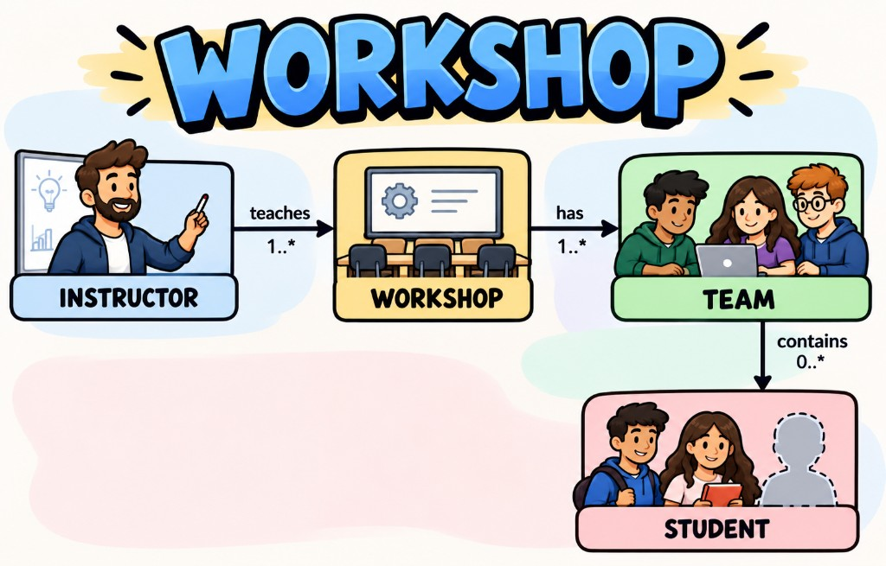
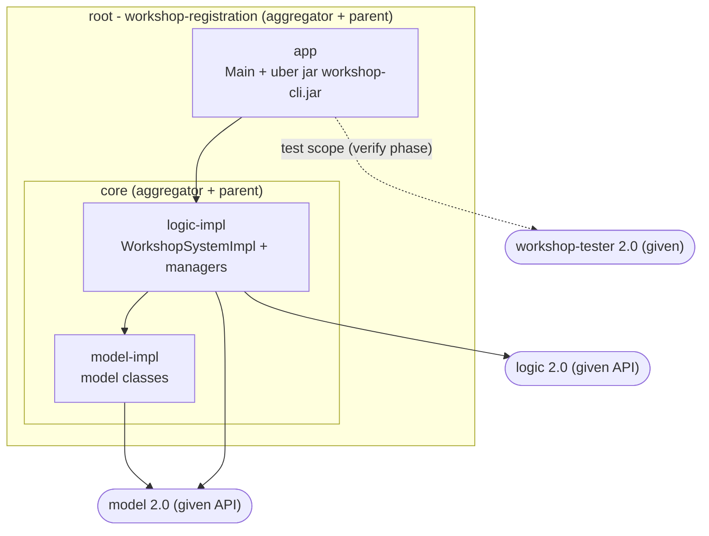
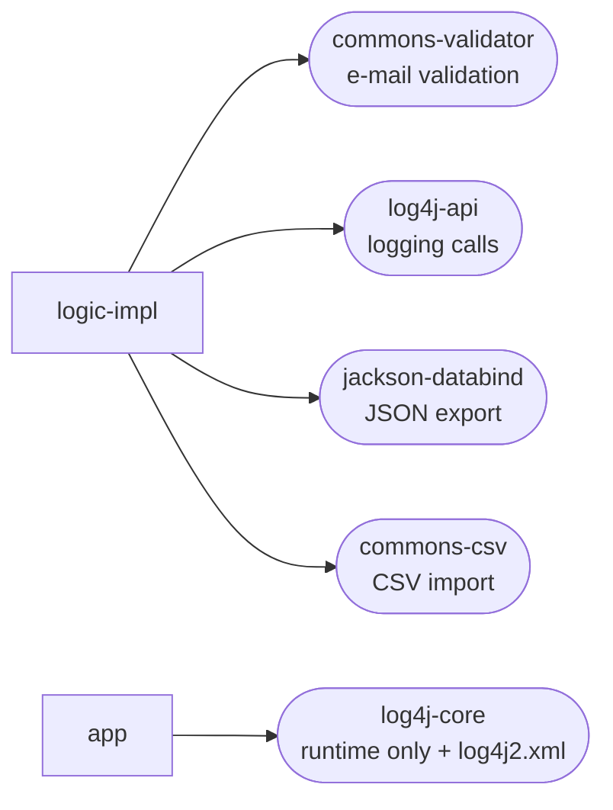

# Workshop Registration System



A registry for university workshops: instructors teach workshops, students
form teams, and every team takes part in one workshop. The system lives
entirely in memory and is used through a single Java entry point,
`WorkshopSystem`.

The project grows over a series of exercises. It started as a plain Java
implementation of a given API, and has since become a multi-module Maven
build with external libraries, JSON export, CSV import and a runnable
command line application. Each stage is marked by a git tag:
`EX1-Vanilla` for the first, `EX2-Maven-Evolution` for the current one.

---

## Part 1 – The core system

The first exercise defined the domain through a set of interfaces that were
given as jars and could not be changed: `Person`, `Instructor`, `Student`,
`Workshop`, `Team`, and the `WorkshopSystem` that creates and queries all of
them. The task was to implement those interfaces with nothing but plain Java:
no build tool, no frameworks and no external libraries.

### The domain

Four kinds of objects take part in the system. An **instructor** teaches
workshops; one instructor may teach several, or none yet. A **workshop** is a
course given by an instructor, and teams register to it. A **team** is a group
of students who take one workshop together. A **student** belongs to at most
one team; a student who is not in any team is called a *free student*.

```text
Instructor 1 ---- * Workshop 1 ---- * Team 1 ---- 1..* Student
```

Because a team belongs to a workshop and a workshop belongs to an instructor,
the system can answer, for any student, which team they are in, who their
team mates are and who their instructor is, without ever storing those facts
twice.

### How it was designed

The guiding idea was that every fact lives in exactly one place. A student
stores only a reference to its team; its team name, its instructor and its
team mates are computed from that team each time they are asked for. If a
workshop gets an instructor after its teams were formed, its students
immediately report the right instructor, because there is no copy that could
fall out of date.

The second idea was that a rejected operation must leave no trace. Every
request is validated completely before anything changes. When a team is
created, all of its members are checked first: each one has to exist, appear
only once in the request and still be free. Only when every member passes is
the team created and are the students moved into it. A request such as
`createTeam("Alpha", workshop, ["s7", "s99"])`, where `s99` does not exist, is
rejected and `s7` stays exactly as it was. The same rule protects the running
ids of workshops and teams: a counter moves forward only after an operation
has fully succeeded, so a failed call never consumes an id.

Relations are kept consistent from both sides. Associating a workshop with an
instructor updates the workshop and the instructor's list of workshops
together, and if the workshop already had another instructor, it is first
removed from that instructor's list. Workshops compare by their id
(`equals` and `hashCode` are based on it), so associating the same workshop
twice does not duplicate it, and looking up the students of a workshop finds
every team whose workshop has that id.

Everything handed out to callers is a copy. Lists returned by the system
cannot be used to change its state, are never `null`, and never contain the
same object twice. Lookups by an unknown key return `null` for a single object
and an empty list for a collection.

### What the system offers

| Method | What it does |
|---|---|
| `createInstructor(id, name, email)` | Registers an instructor with a caller-supplied id |
| `createStudent(id, name, email)` | Registers a student with a caller-supplied id; the student starts free |
| `createWorkshop(name, description)` | Creates a workshop with the next workshop id (1, 2, 3, ...) |
| `associateWorkshopWithInstructor(instructor, workshop)` | Makes the instructor the teacher of the workshop |
| `createTeam(name, workshop, memberIds)` | Creates a team with the next team id and puts the listed students in it |
| `getInstructors()` / `getInstructor(id)` | All instructors / one instructor |
| `getStudents()` / `getStudent(id)` | All students / one student |
| `getWorkshops()` / `getWorkshop(id)` | All workshops / one workshop |
| `getTeams()` / `getTeam(id)` | All teams / one team |
| `getFreeStudents()` | The students that are not in any team |
| `getStudentsOfInstructor(id)` | The students in any team of any workshop taught by that instructor |
| `getStudentsOfWorkshop(id)` | The students in any team of that workshop |

A student can also describe itself: `getTeamName()`, `getInstructor()` and
`getTeamMates()`, which never includes the student. For a free student these
return `null`, `null` and an empty list.

---

## Part 2 – Evolving into a Maven project

The second exercise kept the same system and changed everything around it.
The plain project became a professional multi-module Maven build, the system
gained capabilities that call for real libraries, and the whole thing is now
packaged as one jar that runs with `java -jar`. A second version of the given
API added four methods for getting data in and out of the system through
files, and a new rule: a person can no longer be created with an invalid
e-mail address.

### The module structure

The build has two levels of aggregation and a three-level inheritance chain.
The root pom lists `core` and `app` as its modules and is the parent of both.
`core` is itself both an aggregator and a parent: it lists the two
implementation modules and passes the shared configuration down to them. One
command in the root folder builds every module, in the order their
dependencies require.



`model-impl` holds the implementations of the model interfaces and depends
only on the model API. `logic-impl` holds the `WorkshopSystem` implementation;
it needs both API jars, because the logic interfaces are written in terms of
the model interfaces, and it depends on `model-impl`. `app` holds the command
line application and builds the final jar.

Every version is written exactly once. Library versions, the API version and
the tester version are properties in the root pom, and the root
`dependencyManagement` declares every third-party library, the API jars and
the project's own modules. A child pom names the dependencies it uses and
never repeats a version, so upgrading a library is a one-line change. The
Java level (25) and the source encoding (UTF-8) are set in the same place and
inherited by every module.

### A thinner entry point

As the system grew, a single class holding all of the logic would have become
hard to follow. `WorkshopSystemImpl` is now a thin facade: it keeps its public
no-argument constructor, so it can still be found and created automatically,
and it delegates every call to the class that owns that area.
`InstructorManager`, `StudentManager`, `WorkshopManager` and `TeamManager`
each hold their own objects and rules, while `JsonExporter` and `CsvImporter`
handle the file formats.

### New capabilities and the libraries behind them

Every new capability is implemented with a library chosen for it, declared in
the root pom and added only to the module that needs it.



**E-mail validation.** Instructors and students are now created only with a
valid e-mail address. Instead of a hand-written regular expression, the check
uses the e-mail validator of Apache Commons Validator. An invalid or missing
address is rejected with an `IllegalArgumentException` before anything is
stored, so the same id can be used again with a valid address.

**Logging.** The system logs what happens to it with Log4j 2: every creation
at `info` level and every rejected operation at `warn` level, with the reason.
The logic module depends only on the Log4j API; the implementation and its
configuration file, `log4j2.xml`, belong to the application, which decides
how and where messages are written.

**JSON export.** Three methods write the state of the system as JSON, each
starting from a different point of view: from the instructors down to their
workshops, teams and students; from every student up to its team, workshop
and instructor; and from every team to its students and its workshop. The
documents are built with Jackson as trees, in creation order and in UTF-8.
The model itself is full of cycles (a student knows its team and a team knows
its students), so each document is shaped by hand to avoid them: inside a
team, students appear with their own details only, never with their team
again. A relation that does not exist is written as `null`.

```json
[ {
  "id": "s1", "name": "Alice Cohen", "email": "alice@students.edu",
  "team": {
    "id": 1, "name": "Alpha", "studentIds": [ "s1", "s2", "s3" ],
    "workshop": {
      "id": 1, "name": "Java Workshop", "description": "From objects to streams",
      "instructor": { "id": "i1", "name": "Dana Levi", "email": "dana.levi@univ.edu" }
    }
  }
},
{ "id": "s4", "name": "David Peretz", "email": "david@students.edu", "team": null } ]
```

**CSV import.** Students can be registered from a UTF-8 CSV file with the
header `id,name,email`, read with Apache Commons CSV so that quoted values,
such as a name containing a comma, are handled correctly. Each line is
registered exactly as if `createStudent` had been called, in file order; the
import stops at the first rejected line and keeps the students registered
before it.

| Library | Module | Scope | Role |
|---|---|---|---|
| commons-validator | `logic-impl` | compile | E-mail validation |
| log4j-api | `logic-impl` | compile | Logging calls |
| log4j-core | `app` | runtime | Logging implementation, configured by `log4j2.xml` |
| jackson-databind | `logic-impl` | compile | Building and writing the JSON documents |
| commons-csv | `logic-impl` | compile | Reading the CSV import |
| JUnit Jupiter | `model-impl`, `logic-impl` | test | Unit tests |
| workshop-tester | `app` | test | The course tester, run by the build |

### The application and the runnable jar

The `app` module is a small command line application, `workshop-cli`. It
creates an instructor with two workshops, loads the demo students from a CSV
file, forms a team and leaves one student free, then writes
`instructors.json`, `students.json` and `teams.json` to the current folder and
logs what it did.

The module builds a single jar, `workshop-cli.jar`, with the Maven Shade
plugin. It holds the application, the project's modules, the API classes and
every runtime library, and its manifest names the main class, so it runs with
`java -jar`. Test-only dependencies, the course tester among them, are left
out of it.

### Quality checks built into the build

The build checks itself on every run. Unit tests cover the model and the
logic: workshop equality by id, team mates that never include the student
himself, defensive copies, rejected operations that leave the system
untouched, atomic team creation and moving a workshop between instructors.
After the jar is packaged, the course tester runs against it in the `verify`
phase with the exec plugin, and a failing scenario fails the whole build. The
current result is 15 of 15 scenarios and 201 of 201 checks.

---

## Building and running

### Installing the given API jars

The API jars are not published on Maven Central, so they have to be installed
into the local Maven repository (`~/.m2`) once on every computer, before the
first build. Run these commands from the folder that holds the jars:

```
mvn install:install-file -Dfile=model-2.0.jar -DgroupId=patmal.workshops -DartifactId=model -Dversion=2.0 -Dpackaging=jar
mvn install:install-file -Dfile=logic-2.0.jar -DgroupId=patmal.workshops -DartifactId=logic -Dversion=2.0 -Dpackaging=jar
mvn install:install-file -Dfile=workshop-tester-2.0.jar -DgroupId=patmal.workshops -DartifactId=workshop-tester -Dversion=2.0 -Dpackaging=jar
```

In PowerShell, wrap each `-D...` argument in quotes, for example
`"-DgroupId=patmal.workshops"`; otherwise PowerShell splits it at the dot.

### Building

From the root of the repository:

```
mvn clean install
```

This compiles every module, runs the unit tests, packages
`app/target/workshop-cli.jar` and runs the tester. A successful build ends
with `RESULT: ALL OK` followed by `BUILD SUCCESS`.

### Running the application

```
java -jar app/target/workshop-cli.jar
```

By default the demo students come from the `students.csv` bundled in the jar;
the path of another CSV file can be passed as an argument.

### Running the tester by hand

From a folder that holds both jars (on Linux and macOS use `:` instead of `;`):

```
java -cp "workshop-tester-2.0.jar;workshop-cli.jar" patmal.workshops.main.Main
```

---

## Project layout

| Module | Content |
|---|---|
| `core/model-impl` | `PersonBase`, `InstructorImpl`, `StudentImpl`, `WorkshopImpl`, `TeamImpl` |
| `core/logic-impl` | `WorkshopSystemImpl`, the four managers, `Emails`, `JsonExporter`, `CsvImporter` |
| `app` | `Main`, `log4j2.xml`, `students.csv`, and the `workshop-cli.jar` build |
| `docs` | Images used by this README |

All packages start with `patmal.workshops.student.impl`. The given interfaces
are used exactly as provided and are never modified.
