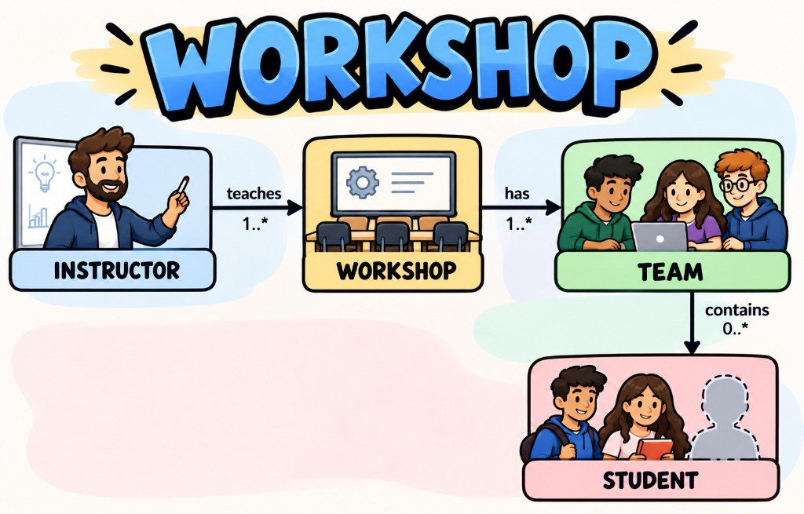

# Workshop Registration System (EX1 - Vanilla)

An in-memory implementation of the workshop registration API: instructors,
workshops, students and the teams students form to take part in a workshop.



## What the system does

The system is a small registry that lives entirely in memory. There is no
database and no user interface: everything is created and queried through
Java calls on a single `WorkshopSystem` object.

It keeps track of four kinds of objects:

- **Instructor** - a person who teaches workshops. An instructor may teach
  several workshops, or none yet.
- **Workshop** - a course given by an instructor. Teams register to it.
- **Team** - a group of students that take a specific workshop together.
- **Student** - a person who takes part in a workshop as a member of a team.
  A student belongs to at most one team. A student who is not in any team is
  called a *free student*.

The relations between them:

```text
Instructor 1 ---- * Workshop 1 ---- * Team 1 ---- 1..* Student
```

Because a team belongs to a workshop and a workshop belongs to an instructor,
the system can tell, for every student, which team they are in, who their
team mates are, and who their instructor is.

### Operations

Creating things:

| Method | What it does |
|---|---|
| `createInstructor(id, name, email)` | Registers a new instructor with a caller-supplied id |
| `createStudent(id, name, email)` | Registers a new student with a caller-supplied id. The student starts free |
| `createWorkshop(name, description)` | Creates a workshop and assigns it the next workshop id (1, 2, 3, ...) |
| `associateWorkshopWithInstructor(instructor, workshop)` | Makes the instructor the teacher of the workshop |
| `createTeam(name, workshop, memberIds)` | Creates a team in the workshop, assigns it the next team id (1, 2, 3, ...) and puts the listed students in it |

Querying:

| Method | What it returns |
|---|---|
| `getInstructors()` / `getInstructor(id)` | All instructors / one instructor by id |
| `getStudents()` / `getStudent(id)` | All students / one student by id |
| `getWorkshops()` / `getWorkshop(id)` | All workshops / one workshop by id |
| `getTeams()` / `getTeam(id)` | All teams / one team by id |
| `getFreeStudents()` | All students that are not in any team |
| `getStudentsOfInstructor(id)` | All students in a team of any workshop taught by that instructor |
| `getStudentsOfWorkshop(id)` | All students in a team of that workshop |

Every student can also answer questions about itself: `getTeamName()`,
`getInstructor()` and `getTeamMates()` (the other members of the team, never
the student himself/herself). For a free student these return `null`, `null`
and an empty list.

## Structure

| Folder | Content |
|---|---|
| `model-impl` | Implementations of the model interfaces (`Person`, `Instructor`, `Student`, `Workshop`, `Team`) |
| `logic-impl` | Implementation of `WorkshopSystem` (the single entry point) |
| `lib` | The given API jars (`model-1.0.jar`, `logic-1.0.jar`) |
| `artifacts` | The built implementation jars |
| `docs` | Images used by this README |

The project is split into two modules, as recommended by the exercise. The
model module depends only on the API interfaces; the logic module depends on
the API interfaces and on the model module. The given interfaces are used as
they are and are never modified.

### Model classes (`patmal.workshops.model.impl`)

- `InstructorImpl` - an instructor: the personal details (`id`, `name`,
  `email`) every person has, and the list of workshops they teach.
- `WorkshopImpl` - a workshop with a system-assigned id, a name, a description
  and its instructor (`null` until the workshop is associated with one).
- `TeamImpl` - a team with a system-assigned id, a name, its workshop and its
  list of students.
- `StudentImpl` - a student. Besides the personal details (`id`, `name`,
  `email`), the only thing a student stores is a reference to its team
  (`null` for a free student). Everything else is derived from that team:
  - `getTeamName()` - the name of the team
  - `getInstructor()` - team, then workshop, then instructor
  - `getTeamMates()` - the team members without the student himself/herself

### Logic class (`patmal.workshops.logic.impl`)

- `WorkshopSystemImpl` - the single entry point. It is `public` and has a
  `public` no-argument constructor, so the tester can find it on the
  classpath and create it automatically. It holds all the objects, creates
  them, connects them and answers the queries.

## Design notes

- **Maps keyed by id.** Instructors, students, workshops and teams are kept in
  `LinkedHashMap`s keyed by their ids, so every lookup by id is fast.
  `LinkedHashMap` also keeps the creation order, which makes the returned
  lists predictable and easier to debug (the API does not require any order).
- **Running ids.** Workshop and team ids are running numbers starting from 1,
  each kind with its own counter. A counter is advanced only after an
  operation has fully succeeded, so a rejected operation never consumes an id.
- **Validate first, then change.** Every request is fully validated before any
  state changes, so a rejected operation leaves the system (data and id
  counters) exactly as it was. In `createTeam`, all member ids are checked
  first: each one must exist, must not appear twice in the request, and must
  belong to a free student. Only when every member passes is the team created.
  For example, `createTeam` with `["s7", "s99"]`, where `s99` does not exist,
  is rejected and `s7` stays a free student.
- **Both sides of every relation stay consistent.** Associating a workshop with
  an instructor updates the workshop and the instructor's list of workshops.
  If the workshop already had another instructor, it is removed from that
  instructor's list first. Creating a team updates both the team's list of
  students and each student's team.
- **Derived data instead of copies.** A student does not store its team name,
  instructor or team mates; they are computed from its team every time. Each
  fact is stored in one place only, so it can never get out of sync. For
  example, if a workshop is associated with an instructor after its teams were
  formed, its students immediately report the right instructor.
- **Defensive copies.** All returned lists are copies of the internal state,
  so callers cannot change the system by modifying a list they received.
  Returned lists are never `null` and never contain the same object twice.
- **Unknown keys.** `getX(id)` returns `null` and `getStudentsOfX(id)` returns
  an empty list. The API leaves this choice open; it is applied consistently
  and documented in `WorkshopSystemImpl`.
